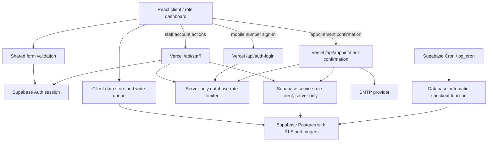

# Runtime Architecture & Security Boundaries

## High-level request path

## Trust boundaries

- **Browser:** Public, untrusted environment. Validation here improves usability but can be bypassed.
- **Supabase Auth:** Identity and email-confirmation flow. SMTP/auth email templates must be configured in Supabase for registration, invitations, and password reset.
- **Postgres/RLS/functions:** Authoritative ownership, role, appointment shift/time, narrowly scoped profile access, and attendance status controls. Active-doctor picker data is returned by `get_ihms_doctor_directory()` with only directory fields; it does not expose email, phone, demographics, or raw profile details.
- **Vercel API routes:** Server-only operations that require service-role privileges. Verify the bearer token, reload the profile/role on the server, rate-limit, validate request bodies, and return safe response messages.
- **SMTP:** External email delivery dependency. A successful appointment save is not rolled back solely because an email provider fails; show a warning that the appointment saved but the email failed.

## Data flows

- A patient registers through Supabase Auth. The `on_auth_user_created` trigger provisions `profiles` and validates optional blood group metadata.
- The authenticated browser calls allowed data operations. RLS and database triggers enforce ownership/role rules independently of the UI.
- Patient booking and receptionist quick booking use the same shift slot generator; the appointment insert trigger checks slot format and the doctor's persisted shift. The database accepts quarter-hour starts only inside the doctor’s current morning/evening OPD shift.
- Staff accounts are created or invited only through `/api/staff`, where the service role remains server-side.
- Email sign-in uses Supabase Auth directly. Mobile sign-in posts to `/api/auth-login`, which rate-limits hashed IP/phone buckets, resolves a unique phone-to-profile mapping server-side, delegates password verification and email-confirmation checks to Supabase Auth, then returns only the access/refresh tokens. It never returns the matched email or exposes profile lookup to anonymous clients.
- Email confirmation sends only after an authenticated patient requests it for their own appointment. A database claim record prevents duplicate sends and API rate limits reduce abuse.

## Rate limiting model

`public.consume_ihms_api_rate_limit(text, integer, integer)` atomically increments hashed keys. Only `service_role` can execute the function or access the limiter table. The current endpoints use IP and account buckets (staff provisioning: 60/IP/5 minutes, 120/user/15 minutes, 10 account creations/user/15 minutes; appointment email: 40/IP/5 minutes and 20/user/15 minutes; mobile login: 30/IP/5 minutes and 8/phone/15 minutes). Treat these as a baseline rather than a substitute for WAF/DDoS protection, abuse monitoring, email-provider quota controls, and load testing.

## Performance model

- Role dashboards are dynamic imports; only the selected dashboard is loaded. Shared animated loading/skeleton states and dismissible global success/error feedback make startup and operation status clear.
- Large public hero and seeded doctor avatar imagery is converted to WebP; doctor asset references are Vite-managed imports.
- Supabase Realtime is the primary synchronization channel. The fallback refresh interval backs off to 30 seconds and avoids network refresh when the page is hidden.
- Further optimization should be guided by profiling: route-level chunk measurements, React profiler traces, slow-query logs, Web Vitals, and representative low-end-device tests.

## Known architecture considerations

- The staff API rejects doctor shift changes that would conflict with known future online/follow-up appointments, but it does not automatically reschedule them and the pre-check/update are separate operations. Administrators should review the upcoming schedule and verify concurrent booking/shift-change behavior in staging.
- Automatic checkout depends on the latest SQL schema plus the scheduled `pg_cron` job in `supabase/attendance-auto-checkout-cron.sql`; the browser fallback is local/demo-mode only; production disables client-side checkout writes to avoid racing the authoritative Cron update. Review job runs in Supabase Cron History / `cron.job_run_details`; a daily cleanup task retains 14 days of history.
- Rate limiting depends on the latest SQL schema being applied first. If the RPC is missing/unavailable, sensitive APIs fail closed with a `503` rather than bypassing rate limits.
- This app has not been audited for clinical safety, medical-record compliance, penetration resistance, disaster recovery, or regulatory requirements. Complete those reviews before processing real patient data.
